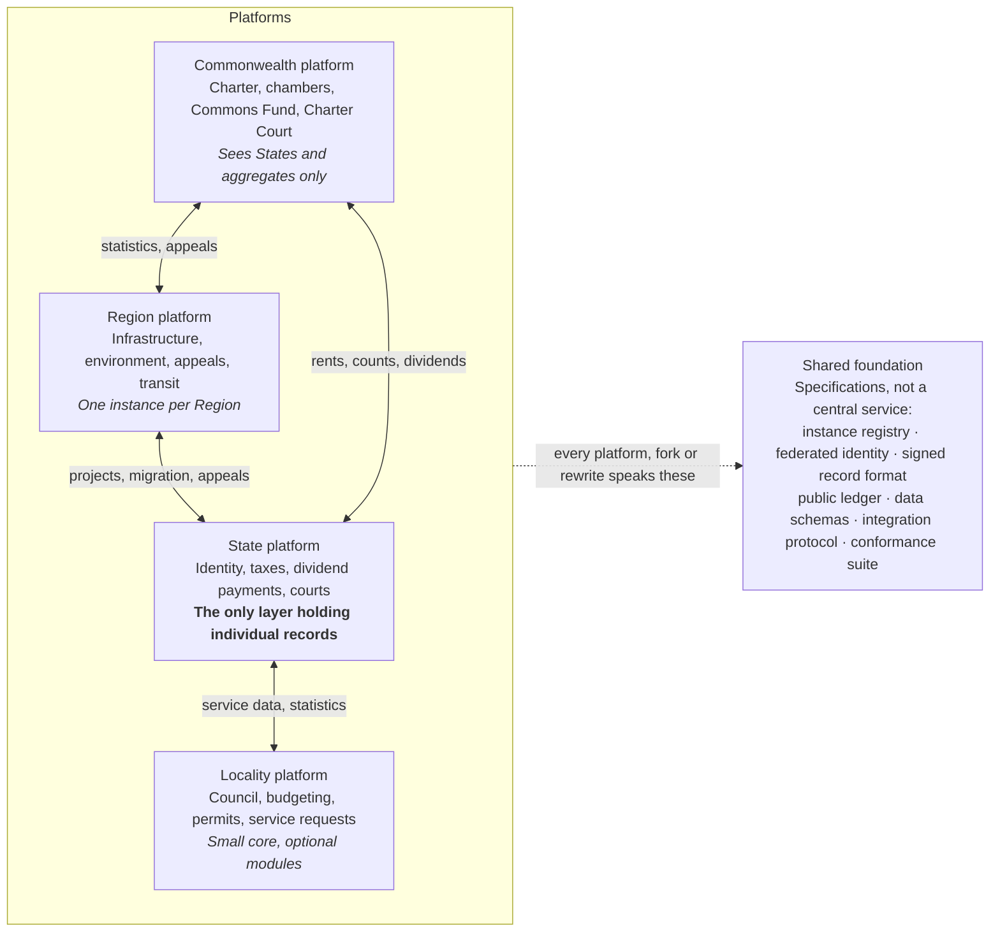

# Commonwealth Platforms Plan

How the web platforms that define, run and connect each layer of the [Polycentric Commonwealth](polycentric-commonwealth.md) will be built.

## 1. Goals and design principles

We will build four open-source reference platforms, one per layer: Commonwealth, Region, State and Locality. Each runs on its own and can be forked or replaced by any instance. They connect only through a small set of shared, versioned protocols, so a State can rewrite its platform completely and still interoperate with everyone else.

This is the broad-strokes version. Each platform and module will be expanded in later passes.

### Principles

1. **Protocols over platforms.** Interoperability lives in open specifications (data formats, APIs, signatures), not in shared code. Any implementation that speaks the protocols is a valid platform.
2. **Independent by default.** Every platform works fully offline from the others. Integration adds value but is never required to function.
3. **Forkable from day one.** Each platform is a modular, open-source reference implementation that any instance can fork, configure, extend or discard.
4. **Configuration before code.** Most local variation (laws, tax rates, languages, offices, workflows) is expressed as configuration and content, so instances change behaviour without forking.
5. **Transparent by design, private by design.** Government actions are public and auditable by default. Personal data is minimized, held at the lowest layer that needs it, and never centralized.
6. **Verifiable, not trusted.** Records that cross layers are cryptographically signed and append-only, so any party can check them without trusting the sender.
7. **Mirrors the charter.** Each platform can do only what its layer is allowed to do. Enumerated powers are reflected in which modules exist and which data each can see.
8. **Accessible to everyone.** Works on low-end phones and slow connections, supports many languages and meets accessibility standards. Assisted access through offices and agents is supported where connectivity is poor.

## 2. At a glance

Each platform runs on its own; arrows are optional, signed message flows. The State platform alone holds individual records.

## 3. Shared foundation

The shared foundation is a set of specifications plus small reference libraries, not a central service. It is the only thing all platforms must agree on, so it is kept deliberately small and changes slowly. Its specifications live in this repository under [`specs/`](../../specs/).

| Component | What it defines | Why it is shared |
| --- | --- | --- |
| Instance registry | Each platform instance's identity, layer, parent instance, public keys and endpoints | Platforms find and verify each other without a central directory owner |
| Federated identity | Person and organization identifiers issued by States, with privacy-preserving credentials (prove "is an adult member" without revealing who) | Dividend eligibility, lottery selection and voting without a global population database |
| Signed record format | Envelope for any cross-layer record: author, layer, type, payload, signature, timestamp | Anyone can verify where a record came from and that it was not altered |
| Public ledger | Append-only, replicated log of official acts: laws, budgets, payments, rulings | Tamper-evident transparency; any party can mirror and audit it |
| Data schemas | Common formats for laws, budgets, statistics, payments, cases, people-counts and geography | Statistics and audits can compare instances; integrations stay simple |
| Integration protocol | Message types, APIs, event subscriptions and versioning rules | Independent implementations can talk to each other |
| Conformance suite | Automated tests an implementation runs to prove it speaks the protocols | Forks and rewrites can verify compatibility before connecting |

### Rules for the foundation

- Specifications are versioned; every platform must support the current and previous major version.
- Changes go through a public proposal process with a reference implementation and conformance tests before adoption.
- Personal data never appears in the public ledger; only aggregate counts and signed acts of government do.
- Reference libraries are provided in a few widely used languages, but implementations in any language are welcome.

### Own the core, adapters at the edges

Existing digital-government projects (identity, civil registration, payments, data exchange, participation tools) vary in quality, and none was designed for a layered, federated system like this one. Stitching several of them together directly would give us their combined data models, release cycles and assumptions. So the foundation follows four rules (see [decision 0003](../../decisions/0003-standards-based-core-with-adapters.md)):

1. **One protocol spine that we own.** All platforms speak only the Commonwealth protocol internally; every record, message and identity follows our schemas.
2. **Built on widely adopted open standards, not other projects' products.** HTTP and JSON, OpenAPI for interfaces, JSON Schema for data, standard signatures such as Ed25519, and W3C Verifiable Credentials for privacy-preserving eligibility proofs. Records are delivered by HTTPS to each instance's inbox, with signed receipts ([decision 0007](../../decisions/0007-integration-transport-and-receipts.md)).
3. **Existing systems connect through adapters at the edges.** A State that already runs a national identity or data-exchange system writes or reuses an adapter that translates to our protocol. The core never depends on any of them, and any adapter can be swapped or dropped.
4. **One stack and one shared core library across the four reference platforms,** so our own code stays coherent. Forks may diverge; the reference set should feel like one system.

We borrow ideas rather than code where it helps: the federation and trust model of national data-exchange layers, the building-block boundaries in GovStack's specifications, and published research on fair sortition algorithms.

The parts unique to this design and critical to trust are built by us, carefully: the Commons Fund, dividend settlement, public ledger, verifiable sortition and the charter registry.

## 4. Commonwealth platform

The Commonwealth platform runs the global institutions and the Commons Fund. It holds the least personal data of any layer: it sees States, aggregates and signed acts, not individuals. There is one production instance, but its code is open and anyone can run a mirror or a test instance.

| Module | Purpose | Main users |
| --- | --- | --- |
| Charter and law registry | Authoritative text of the charter and Commonwealth laws, with versions, sunset dates and amendment history | Everyone |
| Legislative workspace | Bill drafting, committee work, amendments and voting for the Citizens' and States' Chambers | Chamber members, staff |
| Sortition engine | Verifiable, auditable random selection of Citizens' Chamber members from State-provided anonymous eligibility pools | Election Commission, public auditors |
| Commons Fund | Rent assessments owed by States, receipts, investment holdings and the dividend calculation by charter formula | Commons Fund, States, auditors |
| Dividend settlement | Sends per-State dividend totals and signed instructions to State payment systems; never holds individual accounts | Commons Fund, States |
| Charter Court docket | Case filing, hearings, rulings and enforcement findings | Court, States, parties |
| Enforcement tracker | The enforcement ladder for each finding, from public notice to sanctions | Executive Council, States, public |
| Inspection and licensing | Weapons verification, frontier AI and biotech licences, inspection reports | Inspection agencies, licensees |
| Statistics hub | Collects State and Region statistics, cross-checks with independent sources and publishes core metrics | Statistics Office, public |
| Audit workspace | Audit plans, findings and follow-ups on every Commonwealth body | Audit Office |
| Public portal | Plain-language view of everything above, with search, alerts and open data downloads | Everyone |

**Key constraint:** the platform must make it technically impossible for the Commonwealth to compile a database of individuals. Dividend payment and lottery selection work through State-held identities and privacy-preserving proofs.

## 5. Region platform

The Region platform coordinates shared infrastructure, environment and appeals among a group of States. Each Region runs its own instance; existing unions such as the EU or African Union would likely adapt it to their current systems rather than adopt it wholesale.

| Module | Purpose | Main users |
| --- | --- | --- |
| Regional council workspace | Agendas, proposals, voting and records for the Region's governing bodies | Council members, staff |
| Infrastructure planner | Shared networks (power grids, rail, water, data links): project pipeline, funding shares, progress | Planners, States, contractors |
| Environmental zones | Watersheds, airsheds, fisheries and protected areas: limits, monitoring data and compliance | Environmental agency, States |
| Disaster reserve | Pooled reserves, readiness plans, activation requests and aid tracking | Emergency managers, States |
| Regional court of appeal | Appeals from State courts on matters within regional jurisdiction | Judges, parties |
| Transit and mobility | Cross-border transit rules, free-movement stage and intake capacity per State | States, migration offices |
| Regional statistics | Aggregates State data, publishes regional metrics, forwards to the Commonwealth | Statistics staff, public |
| Public portal | Open view of regional decisions, projects, spending and data | Everyone |

**Key constraint:** the Region sees aggregate and project data, not personal records. Free-movement capacity is calculated from State-reported counts.

## 6. State platform

The State platform is the largest and most varied, because States hold most law, taxation, welfare and identity. It is also the one most likely to be forked or rebuilt, since many States already have digital-government systems. The reference version is a modular toolkit a State can adopt piece by piece alongside its existing systems, connected through adapters.

| Module | Purpose | Main users |
| --- | --- | --- |
| Civil registry and identity | Births, residency, citizenship and the State-issued identity that backs Commonwealth credentials | Registry office, residents |
| Legislature workspace | Bill drafting, debate, amendments, proportional-representation voting records | Legislators, staff |
| Law and regulation registry | Current and historical State law, linked to Commonwealth law it implements | Everyone |
| Elections | Voter rolls, ranked or approval ballots, counting and auditable results | Election commission, voters |
| Tax and rent collection | Land value assessment, income and business taxes, and the Commons Fund share owed | Revenue agency, taxpayers |
| Dividend and benefits payments | Pays each resident's dividend from Commonwealth settlement plus State benefits; individual accounts live here | Payment agency, residents |
| Floor services | Tracks delivery of the charter floor: primary healthcare, schooling and shelter capacity and coverage | Service ministries, auditors |
| Courts and justice | Case management for State courts, with escalation to Region and Charter Court | Courts, parties |
| Migration office | Entry and residency for movers, applying intake capacity rules | Migration staff, applicants |
| Ownership register | Public beneficial-ownership register for companies, trusts and land | Revenue agency, public |
| Officials' transparency | Asset declarations, meetings with lobbyists and outcome-pay indicators for officials | Ethics office, public |
| Citizen portal | One place for residents to see their dividend, services, cases, votes and requests | Residents |
| Public portal | Open view of laws, budgets, spending and statistics | Everyone |

**Key constraint:** individual data stays here. The State answers verified questions from other layers ("how many eligible adults?", "is this person an eligible adult?") without handing over records.

## 7. Locality platform

The Locality platform serves cities and municipalities, where most people meet government day to day. It needs to be the simplest to install and run, because there will be tens of thousands of instances, many with small budgets and little technical staff. A hosted option run by the State or a cooperative of localities should be available alongside self-hosting.

| Module | Purpose | Main users |
| --- | --- | --- |
| Council workspace | Meetings, agendas, motions, votes and minutes | Councillors, clerks |
| Participatory budgeting | Residents propose and vote on a share of the local budget | Residents, council |
| Local assemblies | Sortition and facilitation tools for local citizens' assemblies | Organizers, members |
| Service requests | Report and track issues such as roads, waste and water | Residents, service crews |
| Zoning and permits | Land-use maps, permit applications and public notice | Planners, applicants |
| Local budget and spending | Budget, contracts and payments, published as they happen | Finance staff, public |
| Schools and local services | Enrolment and capacity for services the locality runs | Service staff, residents |
| Public portal | Open view of everything above, plus local news and events | Everyone |

**Key constraint:** keep the core small. Modules should be optional and installable one at a time, so a village of 2,000 can run only council meetings and service requests while a large city runs everything.

## 8. Integration points

Integrations are signed messages over the shared protocol. Each is optional for the platform's own operation, but some are required by the charter for membership (paying rents, reporting statistics). The first set covers the flows the system cannot work without.

| Integration | Direction | What moves | Required by charter |
| --- | --- | --- | --- |
| Rent reporting and payment | State to Commonwealth | Assessed rents, Commons Fund share owed, payment receipts | Yes |
| Dividend settlement | Commonwealth to State | Per-State total, signed payment instruction; State pays individuals | Yes |
| Eligibility counts | State to Commonwealth | Count of eligible adults and residents (no names) | Yes |
| Sortition draw | Commonwealth to State and back | Commonwealth sends a verifiable random seed; State selects and invites; Commonwealth receives only credentials of those who accept | Yes |
| Statistics | Locality to State to Region to Commonwealth | Core metrics in common schemas | Yes |
| Law cross-references | Any layer | Links from lower-layer laws to the higher-layer law they implement | No |
| Court escalation | State to Region to Charter Court | Case record and rulings | Yes, when appealed |
| Enforcement notices | Commonwealth to State | Findings, deadlines and ladder steps | Yes |
| Infrastructure funding | Region and State | Project shares, disbursements and progress | No |
| Migration capacity | State to Region | Intake capacity and current movement | Yes, once free movement starts |
| Local service data | Locality to State | Floor-service coverage, budgets | No |
| Public ledger mirroring | All layers | Signed acts of government | Yes |

### Integration rules

- Every message is signed by the sending instance and verifiable against the instance registry.
- A platform that is offline or forked keeps working; missed messages are replayed when it reconnects.
- Higher layers can request only the data their enumerated powers require; the protocol has no message type for bulk personal data.
- Each integration has a conformance test, so a rewritten platform can prove it handles it correctly.

## 9. Forking, versioning and governance

Every instance owns its platform outright. The reference platforms are a commons that instances may use, change, share back or abandon; only the protocols are binding.

### Three ways to adapt a platform

1. **Configure.** Change laws, rates, languages, workflows and branding through configuration and content. No code changes; easiest to keep updated.
2. **Extend.** Add or replace individual modules through a documented plugin interface while keeping the core.
3. **Fork or rewrite.** Take the code in any direction, or build from scratch in any technology, and pass the conformance suite to connect.

### Keeping forks healthy

- **Open licences.** Code is Apache-2.0 and documentation and specifications are CC BY 4.0, so anyone can use the work for any purpose with attribution ([decision 0001](../../decisions/0001-licensing.md)).
- **Trademark and certification.** The project name and a "conformant" mark are held by the foundation. Anyone can fork, but only implementations that pass the conformance suite and honour the charter may call themselves Commonwealth platforms.
- **Upstream welcome, never required.** Improvements made by one State can be offered back to the reference platform and shared with others.
- **Module catalogue.** A public catalogue of modules and forks by layer, so a State can borrow another State's welfare module or a city's permits module.
- **Semantic versioning** for platforms and protocols, with long-term-support releases for small instances that cannot upgrade often.
- **Security advisories** shared across all known forks, since a weakness in one copy is likely in others.

### Who maintains what

| Asset | Maintainer | Decision process |
| --- | --- | --- |
| Protocols and conformance suite | A standards body with members from every layer | Public proposals, reference implementation, supermajority adoption |
| Reference platforms | An open-source foundation, funded by member contributions | Open governance with maintainers per platform |
| Each instance's deployed platform | That instance | Its own law and procurement rules |

Before the Commonwealth exists, the foundation can be an independent nonprofit, so the platforms are useful to today's governments and civil-society groups from the start.

## 10. Build roadmap and open questions

Build in the order the transition needs, and start with pieces today's governments and civil society can use immediately. Platforms that prove useful before the Commonwealth exists build the trust and adoption the transition depends on.

### Build stages

1. **Stage A: Foundation.** Write version 0.1 of the record format, schemas, instance registry and integration protocol on top of the chosen standards, using the stack in [decision 0004](../../decisions/0004-technology-stack.md). Build a thin reference implementation of the core library and one end-to-end flow, starting with dividend settlement from Commonwealth to State, which exercises identity, signatures, the ledger and cross-layer messaging at once. Add the first conformance tests.
2. **Stage B: Useful today.** Ship standalone modules any existing government or community can adopt now: Locality council workspace, participatory budgeting and citizens' assembly tools; State ownership register and officials' transparency. These need no Commonwealth to be valuable.
3. **Stage C: Phase 0 pilot.** Build the minimum Commonwealth and State pieces for the founding coalition: charter registry, sortition engine for the global citizens' assembly, pilot Commons Fund, dividend settlement and State payment integration, public ledger.
4. **Stage D: Phase 1 economic union.** Add rent and carbon-fee reporting, tax and rent collection, statistics hub and audit workspace.
5. **Stage E: Phase 2 institutions.** Add the legislative workspaces, Charter Court docket, enforcement tracker, Region platform, migration modules and court escalation.
6. **Stage F: Phases 3 and 4.** Add inspection and licensing, scale for great-power States and harden everything for universal use.

### Suggested next deep dives

- [ ] Shared foundation: protocol, record format and identity design
- [ ] Commonwealth platform: Commons Fund and dividend settlement
- [ ] State platform: identity, payments and floor services
- [ ] Locality platform: the minimal core and first modules
- [ ] Region platform

### Open questions

- What public ledger design fits: a replicated signed log, or something heavier?
- Which privacy-preserving credential approach is mature enough for eligibility checks?
- Who funds and hosts the foundation before any Commonwealth institution exists?
