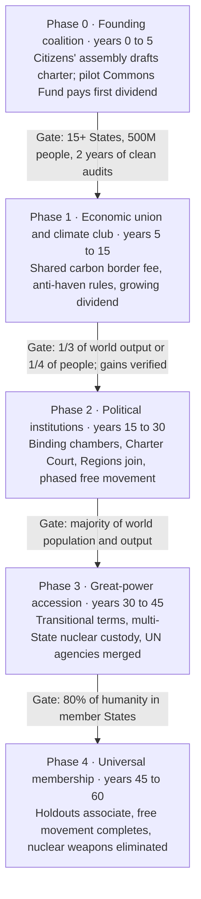

# The Polycentric Commonwealth

A design for a layered system of government with the best chance of creating and maintaining shared prosperity and equal standing for all people, while limiting the harm from the negative sides of human nature. It starts from the world as it is in 2026 and describes a voluntary path to the end state.

## 1. Purpose and design assumptions

The Polycentric Commonwealth is a layered system designed to maximize shared prosperity and equal standing while assuming people will not become better than they are. It does not depend on altruism, wise leaders or a single ideology. It depends on incentives that make self-interest produce public benefit, and on power being too divided to seize.

### Assumptions about human nature

Every mechanism in this document is designed against these traits, not around their absence.

| Trait | Design consequence |
| --- | --- |
| Self-interest | Make the profitable action and the beneficial action the same action |
| Status-seeking | Offer status through service and building, never through domination |
| Tribalism and in-group loyalty | Give groups real self-rule locally so they never need to control the centre |
| Corruptibility of power holders | No office holds enough power, for long enough, to be worth corrupting |
| Fear of scarcity and loss | Guarantee a floor so desperation stops driving crime, extremism and war |
| Short-term thinking | Lock long-term commitments into rules that are hard to change and automatic to enforce |
| Resistance to imposed change | Grow by voluntary accession with visible benefits, never by conquest |

### Design principles

1. **Subsidiarity.** Decide everything at the lowest level that can handle it well.
2. **Exit over voice alone.** People can leave a jurisdiction, so bad governance loses residents and revenue.
3. **Share what nobody made.** Land, resources and the atmosphere belong to everyone; their rents fund the floor.
4. **Reward what people make.** Work, savings and invention are taxed lightly.
5. **Divide every form of power.** Political, economic, military and informational power are kept in separate hands.
6. **Measure and sunset.** Policies carry targets and expiry dates; failures end automatically.
7. **Voluntary and incremental.** Every step must leave its participants better off than staying out.

### Success criteria

The system succeeds if, measured globally and per region:

- No one lives below a defined material floor (food, shelter, healthcare, education, connectivity).
- Median wellbeing rises over each decade.
- Wealth and political influence do not concentrate past set thresholds.
- No war occurs between member jurisdictions.
- Citizens' trust in institutions, measured independently, stays above a set level.
- The system survives the failure of any single institution or leader.

## 2. End-state architecture

The end state has four layers of government plus independent institutions that sit outside every layer. Each layer has an enumerated list of powers; anything not listed belongs to the layer below.

### The four layers

| Layer | Typical size | Exclusive responsibilities |
| --- | --- | --- |
| Commonwealth (global) | All humanity | Climate and atmosphere, oceans and space, pandemics, weapons of mass destruction, frontier AI and biotech safety, the commons dividend, trade and migration rules, the rights charter |
| Region | 50 to 500 million people | Infrastructure networks, regional courts of appeal, environmental zones, disaster reserves, cross-border transit |
| State | 1 to 100 million (today's nations, reshaped over time) | Most law, taxation above the floor, welfare above the floor, policing, education systems, culture and language policy |
| Locality | Cities and municipalities | Zoning, local services, schools, local police, participatory budgets |

A State keeps its identity, flag, language, religion-state settlement and economic model, provided it respects the rights charter and pays its commons rents. This is what makes membership tolerable to very different cultures.

### Commonwealth institutions

- **Citizens' Chamber.** 1,000 members selected by stratified lottery from all adults, serving single two-year terms. It proposes and vetoes legislation and appoints auditors.
- **States' Chamber.** Delegates elected by member States, with votes weighted by the square root of population. This balances large and small States without giving either a veto over the other.
- **Executive Council.** Nine members, each heading one global domain, nominated by the States' Chamber and confirmed by the Citizens' Chamber. Single five-year terms, staggered.
- **Charter Court.** Judges drawn from multiple legal traditions, single twelve-year terms, ruling only on charter and jurisdiction disputes.
- **Independent institutions.** The Audit Office, Statistics Office, Commons Fund, Election Commission and Ombudsman. Each has its own funding formula fixed in the charter so it cannot be starved by politicians it oversees.

Legislation requires a majority in both chambers. Charter amendments require two-thirds of each chamber plus ratification by States holding a majority of the world's population and a majority of States by count.

### Rights charter (minimum content)

1. Life, bodily security and freedom from torture, slavery and arbitrary detention.
2. Freedom of conscience, religion, expression, assembly and the press.
3. Equal standing before the law regardless of sex, ethnicity, religion, origin or belief.
4. Due process and an independent judiciary at every layer.
5. The material floor: food, shelter, basic healthcare, education and connectivity.
6. The right to leave any State, and to enter any State subject to the migration rules in section 6.
7. Privacy from government and corporate surveillance, with narrow, warrant-based exceptions.
8. Participation: a vote in one's State and eligibility for the Citizens' Chamber lottery.

The charter sets floors only. States may grant more rights but never fewer.

## 3. Economic system

The economy runs on competitive markets, but the value of things nobody created is collected and shared equally. This attacks inequality at its largest unearned source while leaving the reward for work, saving and invention intact.

### The Commons Fund

The Commons Fund collects rents on shared resources and pays them out as an equal dividend to every human being.

| Revenue source | Collected by | Share to Commons Fund |
| --- | --- | --- |
| Land value tax (unimproved land only) | States | A fixed share set in the charter; States keep the rest |
| Extraction royalties (oil, gas, minerals) | States | A fixed share, rising for non-renewables |
| Carbon and pollution fees | Commonwealth, collected at the point of extraction or import | All, after an adjustment fund for affected workers |
| Ocean, seabed, orbital and spectrum licences | Commonwealth | All |
| Frontier compute and AI model licences | Commonwealth | A share, rising as automation displaces labour |

Rules that make the Fund durable:

- **The payout formula is in the charter, not the budget.** Alaska's oil fund shows why. Its dividend was once formula-driven, but legislators abandoned the formula and now set the amount themselves, and the [2025 payment was $1,000](https://dor.alaska.gov/department-of-revenue/news-detail/2025/09/22/department-of-revenue-announces-2025-permanent-fund-dividend-amount), down from $1,702 in 2024. A charter formula removes that temptation.
- **Part is invested.** A fixed fraction of non-renewable revenue goes into an endowment so future generations inherit a share of resources consumed today.
- **Paid to individuals, not governments.** Direct payment to a personal account bypasses corrupt intermediaries and makes the benefit of membership visible to every citizen.
- **Equal in purchasing terms is not required.** The same nominal amount is worth far more in poor regions. This is deliberate: it is the main channel of global redistribution, and it does so without aid bureaucracies.

### The material floor

The floor has two parts. The dividend gives cash. States guarantee in-kind basics (primary healthcare, schooling, emergency shelter) to a charter standard, with Commonwealth top-up grants for States that cannot yet afford it. Grants are conditional on audited delivery, not on political alignment.

### Taxation above the floor

States set their own income, consumption and business taxes, within three Commonwealth rules:

1. **A minimum effective corporate tax** to end profit-shifting to tax havens. The existing OECD global minimum tax of 15% is the starting point, though a January 2026 [side-by-side arrangement](https://thefactcoalition.org/policy-brief-oecd-side-by-side-system/) exempted US-headquartered multinationals from key parts, showing how a single holdout can dilute a global floor.
2. **Automatic exchange of ownership information.** Every company, trust and foundation has a public beneficial-owner record. Hidden wealth is the precondition for most corruption.
3. **No tax competition below the floor.** States can compete on services and efficiency, not on becoming hiding places.

### Limits on concentration

The aim is to stop advantage compounding into permanent castes, not to equalize outcomes.

- **Steep inheritance taxation** above a lifetime amount received per heir, with proceeds to the Commons Fund. Giving to many heirs is taxed less than concentrating in one.
- **An annual net-wealth levy** on fortunes above a very high threshold, set as a multiple of global median wealth.
- **Market-share limits** enforced by a Commonwealth Competition Authority for firms operating across States. National competition authorities handle the rest.
- **Separation of money and politics.** No corporate political spending; public funding for campaigns; caps on individual donations; full real-time disclosure.

### Innovation and work

- Patent terms are shortened and supplemented with public prize funds that buy out important inventions for open use.
- Public research funding is pooled globally for problems markets underserve, such as neglected diseases and climate adaptation.
- The dividend lets people retrain, start businesses or care for family without falling into poverty, which raises risk-taking and entrepreneurship.

### Money

States keep their own currencies and central banks. The Commonwealth uses a basket unit of account, the XCU, for the dividend and its own budget ([unit of account](../../specs/unit-of-account.md)). A single currency is never imposed, because the euro's history shows the cost of sharing money without sharing fiscal policy.

## 4. Anti-capture governance

Every office is designed so that holding it is not worth corrupting and abusing it is quickly detected. Five mechanisms work together.

### Sortition with safeguards

Randomly selected citizens cannot be pre-bought, do not need donors and do not campaign. Ireland's experience shows both the promise and the risk. Its assemblies preceded the 2015 marriage equality and 2018 abortion referendums, where the assembly's 64% support closely matched the [66.4% public vote](https://www.communications.gov.uk/?p=591). But a later assembly's recommendations were [heavily defeated in 2024](https://www.iconnectblog.com/the-future-for-citizens-assemblies-in-ireland/), with critics arguing that staff control over expert selection had skewed it.

Safeguards built into the Citizens' Chamber:

- Briefing experts are chosen by a balanced panel of members themselves, with opposing experts guaranteed equal time.
- Staff are rotated and barred from advocacy roles for five years before and after service.
- Members are paid at least the median income of their region, with job protection, so service is not limited to people who can afford it.
- Members vote by secret ballot and cannot be contacted by lobbyists except in recorded public sessions.

### Elections designed against polarization

- **Ranked or approval voting** for executive offices, so the winner must be broadly acceptable rather than the loudest faction's favourite.
- **Proportional representation** in States' legislatures, so no minority is permanently shut out.
- **Independent boundary and election commissions**, with members selected partly by lot.

### Terms and rotation

- Executive and judicial offices have single, non-renewable terms. Without re-election to chase, officials have less reason to serve donors.
- No official may take a paid role with an entity they regulated for five years after leaving office.
- Offices are staggered so no single election can capture an entire branch.

### Pay linked to outcomes

Senior officials receive a base salary plus a deferred bonus paid five years after leaving office. The bonus depends on independently measured outcomes during their term:

- Income growth of the poorest 20% of their jurisdiction.
- Healthy life expectancy.
- Measured corruption and institutional trust.
- Environmental indicators.

Deferral rewards lasting results over short-term booms. Indicators are chosen by the Statistics Office, not the officials being measured.

### Transparency that runs one way

- **Open for power.** Officials' finances, meetings, communications with lobbyists and budget spending are published in near real time.
- **Closed for citizens.** Personal data is protected by the charter. Government surveillance requires a warrant from an independent court and is logged for later audit.
- **Protected whistleblowers.** Whistleblowers receive legal protection, relocation rights across States and a share of recovered funds.

### Checks among institutions

No institution oversees itself. The Audit Office audits the Executive; the Citizens' Chamber appoints and can dismiss auditors; the Charter Court reviews all of them; and States can collectively suspend a Commonwealth action by a supermajority while the Court rules.

## 5. Security and enforcement

The Commonwealth enforces its rules mainly through money and access, and only rarely through force. Military power stays divided so that no one can use it to take over the system.

### Enforcement ladder

Responses escalate one step at a time, and each step requires a Charter Court finding.

1. **Public finding** of a violation, with a deadline to remedy.
2. **Withholding** of Commonwealth grants and the State government's share of rents. Citizens' dividends are never withheld, so ordinary people are not punished for their rulers.
3. **Suspension of voting rights** in the States' Chamber.
4. **Targeted sanctions** on responsible officials: asset freezes and travel bans.
5. **Trade measures** by all member States.
6. **Protective force**, only to stop mass atrocities or weapons-of-mass-destruction development, and only under the multi-key rule below.

### Force without a single army

- **States keep defensive forces**, capped in offensive capability by treaty and verified by inspection.
- **A small Commonwealth Protection Force** is built from rotating contingents contributed by many States, with no contingent larger than a set share of the whole.
- **Multi-key deployment.** Using the force requires a Charter Court finding, a two-thirds vote of the States' Chamber and a majority of the Citizens' Chamber. Any one can stop it.
- **No standing command.** Commanders rotate and cannot serve consecutive terms.

### Weapons of mass destruction

Nuclear, biological and chemical weapons are reduced in verified, reciprocal stages (section 7). The Commonwealth runs inspection agencies with the right to visit any site on short notice. In the end state, residual nuclear deterrence is held under multi-State custody, as a hedge against breakout, until verification is trusted enough to eliminate it.

### Frontier technology

Advanced AI and synthetic biology create risks that cross every border. The Commonwealth licenses the largest compute facilities and the most dangerous laboratory work, inspects them and requires safety testing before deployment. Everything below those thresholds stays with States, so ordinary innovation is not slowed.

### Policing and justice

Policing stays local and accountable to localities and States. The Commonwealth handles only crimes defined in the charter: genocide, crimes against humanity, smuggling weapons of mass destruction and large-scale cross-border corruption.

## 6. Weak points and how they are addressed

Each known weakness has at least two independent defences, so the failure of one does not expose the system. The transition problem is large enough to get its own sections (7 and 8).

### Free movement and brain drain

The risk is that skilled people leave poor regions for rich ones, and that rich regions face migration faster than they can absorb it.

- **Phased opening.** Free movement starts with students, workers holding job offers and family members, then expands as the income gap between regions narrows below charter thresholds.
- **Absorption-linked pace.** Each State has an annual intake capacity calculated from housing construction, labour demand and population. Intake above capacity is deferred, not refused.
- **Origin compensation.** For ten years after moving, a share of a migrant's income tax is paid to their region of origin, which compensates for the cost of their education.
- **Remote work and return incentives.** Cross-border remote employment is made legally simple, so talent can earn rich-region wages while living at home.
- **The dividend reduces push factors.** A guaranteed income makes staying home viable, so fewer people are forced to move.

### Mandate creep at the global level

The risk is that the Commonwealth gradually expands into a distant, unaccountable superstate.

- **Enumerated powers.** The Commonwealth may act only in the domains listed in section 2. Everything else is reserved to lower layers.
- **Budget cap.** Commonwealth spending, excluding the dividend it passes through, is capped as a small fixed share of world output in the charter.
- **Subsidiarity review.** Any State can challenge a Commonwealth law as outside its powers. The Charter Court must rule within a fixed period, and the burden of proof falls on the Commonwealth.
- **Collective nullification.** States representing two-thirds of members can suspend a Commonwealth law pending review.
- **Automatic sunset.** Commonwealth laws expire after ten years unless renewed.
- **Exit right for States.** A State may leave after a referendum and a two-year notice period. It loses Commonwealth benefits but its citizens keep their individual rights to move. The credible threat of exit disciplines the centre.

### Deep disagreements about values

The risk is that libertarians, socialists, religious traditionalists and liberals each find the system intolerable.

- **A thin charter.** The Commonwealth enforces only universal floors. States choose their own economic and social models above them.
- **Optional deeper covenants.** Groups of States can agree to deeper integration among themselves (shared welfare systems, common currencies) without forcing it on others.
- **Something for each tradition.** Libertarians get exit rights, light taxes on work and a small centre. Socialists get the commons dividend and wealth limits. Traditionalists get local cultural self-rule. Liberals get the rights charter.
- **Pilot before mandate.** Contested policies are tested in volunteer regions and evaluated before any wider adoption.

### Authoritarian holdouts

The risk is that authoritarian governments refuse to join and use the time to strengthen themselves.

- **Their citizens can still benefit.** People from non-member States can receive the dividend if they register, building popular pressure for accession.
- **Graduated association.** Authoritarian States can join economic and safety treaties before meeting the political conditions for full membership.
- **A widening gap.** As members prosper, the cost of staying out becomes visible to the holdout's own population and elites.
- **Safe exit for rulers.** Negotiated amnesty and protected retirement for leaders who transfer power peacefully, excluding atrocity crimes.

### Dependency, inflation and loss of work incentives

The risk is that a universal dividend discourages work or simply drives up prices.

- **The dividend is set at a floor, not a comfortable income.** Working always pays more than not working.
- **No withdrawal penalty.** The dividend is never reduced when people earn more, unlike means-tested welfare.
- **Funded from rents, not printed money.** The dividend recycles existing value rather than creating new money, which limits inflation.
- **Phased in where it would be largest relative to local incomes,** with local supply investments (housing, food, energy) to absorb the new demand.

### Gaming the measurements

The risk is that officials manipulate the statistics their pay and grants depend on.

- The Statistics Office is independent, funded by formula and staffed by rotating experts from many States.
- Key indicators are checked against independent sources such as satellite data, household surveys and academic replication.
- Falsifying statistics is a charter crime with personal liability.

### Global tyranny

The risk is the gravest one: a world government that becomes oppressive leaves nowhere to flee.

- Military power stays with States (section 5), so the centre cannot coerce members by force.
- Policing and surveillance stay local and charter-limited.
- States keep a right to exit, and citizens keep a right to move between States.
- A charter clause forbids the Commonwealth from ever acquiring a standing army, a secret police or control over States' communications networks. Amending it requires near-unanimity.

## 7. Transition roadmap

The realistic path is a voluntary club that starts small, pays its members visibly and becomes too costly to stay out of, reaching near-universal membership in roughly 40 to 60 years. Faster is possible only if a major crisis opens a window, as the Second World War did for the United Nations and Bretton Woods. The plan should therefore be kept ready to scale instantly when such a window appears.

The model is the European Union, which began in 1951 as a coal and steel pact among six countries and grew by offering benefits that outsiders wanted. Each phase below advances only when its gate is met, so the system never outruns its own legitimacy.

The years are estimates; the gates, not the calendar, decide when each phase begins.

### Starting point (2026)

Useful building blocks already exist, but each is partial:

- **A global corporate tax floor.** More than 140 jurisdictions agreed to a 15% minimum, though a January 2026 deal diluted it for US multinationals (section 3).
- **Carbon border pricing.** The EU's carbon border mechanism [entered its definitive phase on 1 January 2026](https://trade.ec.europa.eu/access-to-markets/en/news/start-definitive-period-cbam-eu), making importers financially liable for embedded emissions, and the UK plans [its own from January 2027](https://www.customs-declarations.uk/?p=3806). This is the seed of a climate club that rewards members and charges outsiders.
- **Resource dividends.** Alaska has paid citizens an oil dividend since 1982.
- **Citizens' assemblies.** Ireland, Belgium, France and others have used them, with mixed but instructive results.
- **Regional unions.** The EU, African Union, ASEAN and Mercosur are candidate Regions.

### Phase 0: Founding coalition (years 0 to 5)

- A coalition of willing middle powers, foundations and civil-society groups convenes a **global citizens' assembly** of about 1,000 people selected by lot from many countries to draft the charter. Starting with citizens rather than governments gives the charter legitimacy that no single government can claim.
- Founding States (realistically democratic middle powers in Europe, the Americas, Africa and Asia-Pacific) ratify a **founding treaty**: the rights charter, the Commons Fund and the Audit and Statistics Offices.
- Founding States pool a share of carbon fees and resource royalties into a **pilot Commons Fund**, paying a small dividend to their own citizens and to residents of the poorest member States.
- **Gate to Phase 1:** at least 15 States with a combined 500 million people have ratified, and the pilot dividend has been paid and cleanly audited for two years.

### Phase 1: Economic union and climate club (years 5 to 15)

- Members form a **common carbon-pricing area** with a shared border fee. Outsiders exporting to members pay the fee; members do not. This is the main recruitment engine.
- **Beneficial-ownership registers, the minimum corporate tax and anti-haven rules** apply across members, raising revenue and shutting hiding places.
- The **dividend expands** as rents grow, and residents of non-member States can register for a partial dividend, building popular demand for accession.
- The **Citizens' Chamber** begins as an advisory body whose recommendations governments must answer publicly.
- **Gate to Phase 2:** members hold one-third of world output or one-quarter of world population, and independent evaluation shows member citizens' wellbeing rising faster than comparable non-members.

### Phase 2: Political institutions (years 15 to 30)

- The Citizens' Chamber and States' Chamber become **binding legislatures** in the enumerated domains, and the **Charter Court** begins hearing cases.
- Existing regional unions **join as Regions**, carrying their members with them.
- **Phased free movement** begins among members (section 6).
- Members agree to **verified reductions in offensive military capability**, with Commonwealth inspection.
- **Gate to Phase 3:** members hold a majority of world population and output.

### Phase 3: Great-power accession (years 30 to 45)

- With most of the world's markets inside the club, the remaining great powers face rising costs from staying out. Accession is negotiated with **transitional terms**: phased dividends, delayed free movement and guaranteed seats for a period.
- **Nuclear arsenals** move in stages from national control to multi-State custody, reciprocal and verified at each stage.
- **UN agencies are merged** into Commonwealth institutions, and the Security Council veto is replaced by the multi-key rule.
- **Gate to Phase 4:** at least 80% of humanity lives in member States.

### Phase 4: Universal membership (years 45 to 60)

- **Remaining holdouts** are brought in through association agreements, popular pressure and negotiated transitions for their rulers (section 6).
- **Free movement completes** once regional income gaps fall below charter thresholds.
- **Nuclear weapons are eliminated** once verification is trusted.

### What can go faster

Some elements do not need to wait for the phases: beneficial-ownership transparency, citizens' assemblies, resource dividends and carbon dividends can be adopted by any single country now. Each country that adopts them independently shortens the later transition.

## 8. Adoption incentives and the accession ratchet

The system spreads only if joining is in each actor's own interest at every stage. The design gives every major actor a concrete reason to join and makes the cost of staying out rise as membership grows.

### Why each actor joins

| Actor | What they gain | What they fear | How the fear is answered |
| --- | --- | --- | --- |
| Ordinary citizens | A cash dividend, rights guarantees, the ability to move | Losing jobs or culture | Phased free movement, local cultural self-rule, adjustment funds |
| Poor countries | The dividend is large relative to local incomes; access to rich markets; origin compensation for emigrants | Loss of sovereignty, neocolonial control | Equal per-person dividend, weighted States' Chamber, Citizens' Chamber by population |
| Rich democracies | Climate stability, an end to tax havens, fewer refugee crises, a security umbrella | Paying for everyone else; migration surges | Rent-based funding rather than income taxes; absorption-linked migration |
| Middle powers | Far more influence than they have today; protection from great-power pressure | Being dominated by larger members | Square-root weighting, multi-key security, exit right |
| Great powers | Lower defence costs, market access, a say in rules they would otherwise face anyway | Losing status and their veto | Transitional guaranteed seats, prestige of founding roles, gradual nuclear steps |
| Businesses | One set of trade rules, stable carbon pricing, legal certainty | Higher taxes, competition limits | Low taxes on work and profits from productive activity, a single large market |
| Political elites | Status through service; deferred outcome bonuses | Losing power and rent-seeking income | Honourable roles, generous but deferred pay, amnesty for peaceful transfers |
| Authoritarian rulers | Safe retirement, protection of their families' legitimate wealth | Prosecution, loss of everything | Negotiated exit terms, excluding atrocity crimes |

### The accession ratchet

Four mechanisms make each new member raise the pressure on the remaining outsiders.

1. **Club goods.** The dividend, the market, the carbon border exemption, shared research and the security guarantee are available only to members. Their value grows with each member.
2. **Rising outsider costs.** The carbon border fee and anti-haven rules apply to all trade with non-members. The larger the club, the more of an outsider's trade they cover.
3. **Bottom-up pressure.** Citizens of non-member States can see and partly receive the dividend, so the benefit of accession is concrete to voters and not just to diplomats.
4. **Easy entry, costly exit.** Accession is fast for States that meet the charter. Exit is permitted but forfeits club goods, so membership is stable without being a prison.

### Holding the coalition together early

The riskiest period is Phase 0 and Phase 1, when the club is small and outsiders may try to break it.

- **Founding benefits must arrive quickly.** The pilot dividend and visible anti-corruption gains should appear within the first few years.
- **Defection is made costly.** The founding treaty includes binding arbitration and financial penalties for withdrawing within the first ten years.
- **Diverse founders.** Members from every continent prevent the club from being portrayed as a Western or regional project.
- **Non-partisan framing.** The system should be presented and governed so that no single party or ideology owns it in any country.

## 9. Failure modes, metrics and open questions

The system is designed to fail gracefully: any single institution can collapse or be captured without the whole system following it.

### Failure modes and safeguards

| Failure | Early warning sign | Safeguard |
| --- | --- | --- |
| A great power captures the centre | Its nationals dominate senior posts; its interests win most votes | Nationality caps on senior posts, square-root weighting, Citizens' Chamber veto |
| Populist backlash in member States | Exit referendums gaining support | Visible dividend, local self-rule, exit right that releases pressure |
| The Commons Fund is raided | Pressure to change the formula or redirect funds | Formula in the charter; supermajority to change it; payment directly to individuals |
| Gridlock between chambers | Repeated failure to pass renewals | Conciliation committee; status quo continues for one term while sunsets are extended once |
| Technocratic drift | Independent bodies making policy rather than measuring it | Mandates limited to measurement and audit; Citizens' Chamber appoints and dismisses |
| Secession of a Region | Coordinated exit by several States | Exit allowed peacefully; individual rights stay portable; the remaining club stays intact |
| Catastrophic shock (war, pandemic, AI accident) | Emergency powers requested | Emergency powers expire in 90 days unless both chambers renew them |

### Core metrics

The Statistics Office publishes these annually for every State and Region:

- Share of people below the material floor.
- Median real income and income of the poorest 20%.
- Wealth concentration (top 1% share).
- Healthy life expectancy.
- Institutional trust and perceived corruption.
- Political violence and armed conflict.
- Emissions and ecological indicators.

### Open questions

- [ ] How large should the dividend be at each phase, and which rents fund it first?
- [ ] Should the Citizens' Chamber have a full veto or only a suspensive veto?
- [ ] What exact income-gap thresholds should trigger each stage of free movement?
- [ ] How should the system handle States that meet the charter on paper but not in practice?
- [ ] Which founding States are realistic candidates for Phase 0?

### Sources

- [Alaska Department of Revenue: 2025 Permanent Fund Dividend](https://dor.alaska.gov/department-of-revenue/news-detail/2025/09/22/department-of-revenue-announces-2025-permanent-fund-dividend-amount)
- [FACT Coalition: OECD side-by-side system](https://thefactcoalition.org/policy-brief-oecd-side-by-side-system/)
- [UK Government Communication Service: Ireland's Citizens' Assembly on abortion](https://www.communications.gov.uk/?p=591)
- [I-CONnect: The future for citizens' assemblies in Ireland](https://www.iconnectblog.com/the-future-for-citizens-assemblies-in-ireland/)
- [European Commission: Start of the CBAM definitive period](https://trade.ec.europa.eu/access-to-markets/en/news/start-definitive-period-cbam-eu)
- [Customs Declarations UK: CBAM definitive period and the UK carbon border tax](https://www.customs-declarations.uk/?p=3806)
