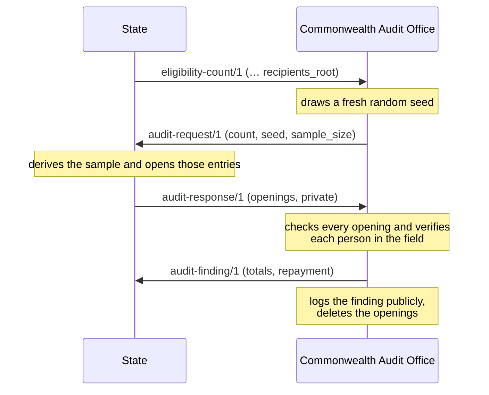

# Eligibility audit

**Status:** Draft, version 0.1. Not yet stable.

How the Commonwealth checks that a State's eligibility count is true, without seeing the State's register. The State commits to an anonymous list of the people it counted; the Audit Office then checks a random sample of them. The reasoning is in [decision 0009](../decisions/0009-eligibility-audits.md).

The reference implementation is the Go package [`audit`](../audit/).

## Recipient list

When a State reports an [eligibility count](integration-protocol.md#message-types), it builds a list with one entry per dividend recipient:

1. For each person, choose a fresh random 32-byte **salt** and compute the **commitment** SHA-256(salt ‖ ref), where **ref** is the State's own reference for that person (for example a resident number) as UTF-8. Salts are never reused, so commitments cannot be linked between periods.
2. Sort the commitments in ascending byte order. No two may be equal.
3. Build a Merkle tree over the sorted commitments exactly as the [public ledger](public-ledger.md#the-log) does, with each commitment as an entry.

The count's `recipients_root` is the tree's root, and its `dividend_recipients` is the number of entries. The State keeps every salt, commitment and position until the count's audit is closed.

## Audit flow

### Request

`audit-request/1`, Commonwealth → State:

| Field | Meaning |
| --- | --- |
| `count` | `id` of the eligibility count being audited |
| `seed` | 32 random bytes, unpadded base64url, chosen after the count was received |
| `sample_size` | Number of entries to check. Recommended 500; at most 600 |

### Sample

The sampled positions are derived from the request, so anyone can check them. For j = 0, 1, 2, …:

1. h = SHA-256("pc-audit-sample/1" ‖ seed ‖ count id as UTF-8 ‖ j as 8-byte big-endian)
2. v = the first 8 bytes of h as a big-endian unsigned integer
3. If v ≥ ⌊2^64 ÷ size⌋ × size, skip it (this removes bias). Otherwise the position is v mod size.
4. Skip positions already chosen. Stop when min(sample_size, size) positions are chosen.

Positions are listed in the order they were chosen.

### Response

`audit-response/1`, State → Commonwealth, with one opening per sampled position, in sample order:

| Field | Meaning |
| --- | --- |
| `request` | `id` of the audit request |
| `count` | `id` of the count |
| `openings` | List of openings |

Each opening:

| Field | Meaning |
| --- | --- |
| `index` | The sampled position |
| `commitment` | The commitment at that position |
| `salt` | Its salt |
| `ref` | The State's reference for the person |
| `name` | The person's full name |
| `birth_date` | Date of birth, YYYY-MM-DD |
| `inclusion` | Inclusion proof for `index` in the recipient list |

**This is the only message type that carries personal data.** It MUST contain only the sampled people and only these fields. It MUST NOT be logged in any public ledger. The Audit Office MUST delete it once it has issued the finding.

### Checking a response

The Audit Office checks that:

1. The openings are for exactly the sampled positions, in order.
2. Each commitment equals SHA-256(salt ‖ ref) and is included at its position in a tree of `dividend_recipients` entries with root `recipients_root`.
3. No `ref` appears twice in the sample.

An opening that fails any of these checks counts as **unverified**. Every opening that passes is then verified in the field: auditors confirm, through independent records or in person, that the person exists, is alive and lives in the State. People who cannot be confirmed are also unverified.

A State that does not send a valid response within the deadline set by the Audit Office (recommended 30 days) is treated as if every sampled entry were unverified.

### Finding

`audit-finding/1`, Commonwealth → State, also logged in the Commonwealth's public ledger:

| Field | Meaning |
| --- | --- |
| `count` | `id` of the count |
| `request` | `id` of the audit request |
| `sampled` | Number of entries checked |
| `unverified` | Number that failed |
| `estimated_excess` | round(`unverified` × recipients ÷ `sampled`), rounding halves up |
| `unit` | Unit of account |
| `per_person` | The settlement's per-person amount |
| `multiplier` | Penalty multiplier, as a decimal string. Recommended `"3"` |
| `repayment` | `estimated_excess` × `per_person` × `multiplier` |

The repayment is charged to the State government's share of commons rents. It is never taken from residents' dividends.

## Limits

- Sampling estimates the share of entries that are not real residents. It catches people who do not exist, have died or have moved away.
- It does not reliably catch one real person counted twice, unless both entries are sampled. Uniqueness within and across States needs the federated identity specification.
- Inflation of a fraction of a percent may go undetected in one audit, but remains unprofitable on average because of the multiplier.

## Still to decide

- [ ] Statistical cross-checks against independent population estimates, and caps on settlement while a count is disputed.
- [ ] How the State contests a finding before the Charter Court.
- [ ] Audit frequency: every count, or a random share of counts.
- [ ] Secure transport for the response beyond TLS, such as encrypting it to the Audit Office's key.
