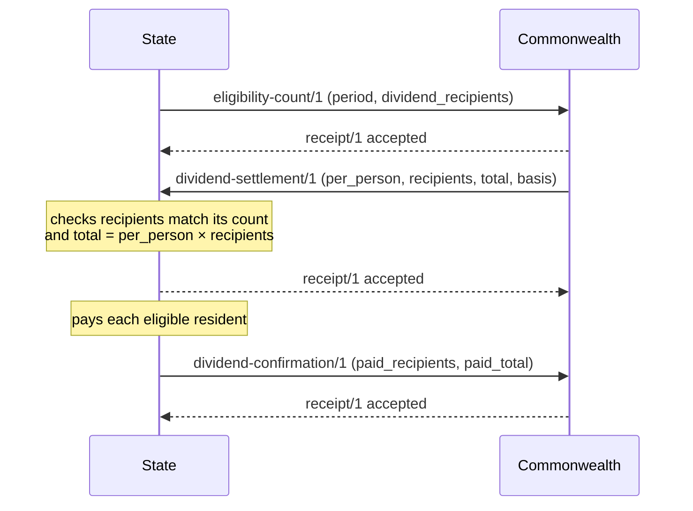

# Integration protocol

**Status:** Draft, version 0.1. Not yet stable.

How instances send each other [signed records](record-format.md), and how they confirm delivery. The design-level list of integrations is in the [platforms plan](../docs/design/platforms-plan.md#8-integration-points); the reasoning behind this draft is in [decision 0007](../decisions/0007-integration-transport-and-receipts.md).

The reference implementation is the Go package [`protocol`](../protocol/). The command `go run ./cmd/pcdemo` runs the dividend settlement flow below between a Commonwealth and a State over HTTPS.

## Principles

- **Optional for operation.** A platform keeps working when disconnected; senders retry until delivered.
- **Least data.** Each message type carries only what the receiving layer's enumerated powers require. There is no message type for bulk personal data.
- **Signed end to end.** Every message is a signed record, verified against the [instance registry](instance-registry.md). TLS protects confidentiality, not identity.
- **Versioned.** Message types carry a major version; recipients accept the current and previous major version.

## Delivery

1. The sender looks up the recipient's `base` endpoint in its instance description.
2. It sends `POST <base>inbox` with `Content-Type: application/json` and one signed record as the body. The record MUST set `to` to the recipient's instance identifier. Bodies larger than 1 MiB MAY be refused.
3. The recipient checks, in order:
   1. The body is a valid signed record.
   2. `to` is the recipient's own identifier.
   3. The message type is allowed from the sender's layer to the recipient's layer (see the table below).
   4. The record's layer matches the sender's instance description, and its signing key is trusted and was valid at `issued_at`.
   5. `issued_at` is no more than 5 minutes in the future by the recipient's clock.
   6. The record has not been accepted before (by `id`).
   7. The application accepts the content (for example, a settlement total is correct).
4. The recipient replies with a signed `receipt/1` record addressed to the sender:
   - HTTP 200 with status `accepted` when the record is accepted.
   - HTTP 200 with status `duplicate` when a record with the same `id` was already accepted. Nothing is processed twice.
   - HTTP 422 (or 400 if the body was not a valid record) with status `rejected` and a reason code otherwise.
5. The sender verifies the receipt: it must be signed by the recipient, addressed to the sender, and name the sent record's `id`. A sender that receives no valid receipt SHOULD retry the same record later.

## Receipt

Payload of a `receipt/1` record ([schema](schemas/receipt-1.json)):

| Field | Meaning |
| --- | --- |
| `record` | `id` of the record being acknowledged; empty if the body could not be parsed |
| `record_type` | `type` of that record, if known |
| `status` | `accepted`, `duplicate` or `rejected` |
| `reason` | For rejections: `invalid`, `not-addressed`, `type-not-allowed`, `untrusted`, `future-dated` or `refused` |
| `detail` | Optional human-readable explanation |

## Message types

| Type | From → to | Purpose | Schema |
| --- | --- | --- | --- |
| `eligibility-count/1` | State → Commonwealth | Counts of residents, adults and dividend recipients for a period; no names | [schema](schemas/eligibility-count-1.json) |
| `dividend-settlement/1` | Commonwealth → State | Per-person dividend and total owed for a period, based on an eligibility count | [schema](schemas/dividend-settlement-1.json) |
| `dividend-confirmation/1` | State → Commonwealth | Aggregate confirmation that a settlement was paid | [schema](schemas/dividend-confirmation-1.json) |

Planned: `rent-report/1` (State → Commonwealth) and `sortition-seed/1` (Commonwealth → State).

## Dividend settlement flow

Amounts are decimal strings, as the record format requires: up to 18 digits before the decimal point and up to 6 after, with no sign, exponent or leading zeros. Amounts are compared by value, so `"25.5"` and `"25.50"` are equal. The `unit` of account for the dividend is provisionally `XCU`, the Commonwealth's basket unit.

The settlement's `recipients` MUST equal the `dividend_recipients` in the eligibility count named by `basis`, and `total` MUST equal `per_person × recipients`. A State SHOULD refuse a settlement that does not match, and the Commonwealth SHOULD refuse a confirmation whose `paid_total` exceeds the settlement total.

## Still to decide

- [ ] Pulling missed messages from a feed, for instances that cannot accept inbound connections.
- [ ] How long recipients must remember record identifiers for deduplication.
- [ ] Rate limits and abuse protection for inboxes.
- [ ] Batching, if single-record delivery proves too slow for any flow.
- [ ] Describing inbox interfaces in OpenAPI.
